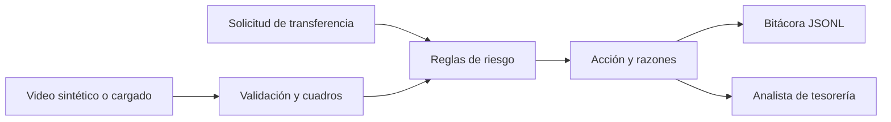

# VeriCall: fuentes, alcance y criterios

## Qué dicen los documentos

Fuentes revisadas en esta carpeta:

1. `GD-Actividades Clave 2026-II.pdf`, pp. 2, 4–11, 15–17 y 34.
2. `1. Entregable sesión 1 - Primer avance del proyecto.docx`.
3. `2. Entregable sesión 2 - Criterios de decisión y condiciones de aceptabilidad VeriCall.docx` (el nombre en disco usa una variante Unicode de «sesión» y «decisión»).

**Objetivo documentado:** diseñar una startup cuyo producto dependa de una decisión crítica sustentada en datos y mecanismos de gobierno. VeriCall plantea decidir, ante una transferencia solicitada por videollamada, entre autorizar o bloquear hasta verificar por un canal alterno. Sirve a tesorería, finanzas y entidades financieras. El daño principal es una transferencia fraudulenta; un falso bloqueo también tiene costo operativo. Fuente: entregable 1, apartados «Startup», «Decisión crítica» y «Criticidad»; PDF pp. 4–7.

**Pregunta del proyecto académico, expresada en el PDF:** «¿Cómo funciona la decisión crítica de nuestra startup y qué mecanismos de Gobierno de Datos permiten confiar en ella?» (p. 9). Los entregables no formulan una pregunta de investigación estadística separada.

**Producto y flujo propuestos por el equipo:** la versión futura se conectaría a la videollamada y al sistema de pagos, analizaría video y audio, contexto de conexión, perfil biométrico e historial de transferencias, y mostraría puntaje, motivos y veredicto a tesorería. El analista confirma en riesgo bajo; en riesgo alto se bloquea y solo se libera tras verificar por otro canal. Esto es una propuesta del entregable 1, no una integración existente.

**Entregable 1 ya establece:** usuarios, problema, decisión crítica, fuentes de datos previstas, costos de errores y riesgos de biometría, sesgo y obsolescencia. **Entregable 2 ya establece:** cinco métricas preliminares, restricciones, puntaje de 0–100 y rangos 0–30 aceptar, 31–70 revisar y 71–100 rechazar. Cuenta nueva o monto superior al límite del cliente exige revisión con cualquier puntaje. Ver la [matriz de trazabilidad](trazabilidad.md).

## Lo que falta en el proyecto académico

| Trabajo | Exigencia del PDF | Estado comprobable aquí |
|---|---|---|
| Avance sesión 3 | Flujo, 3–5 datos críticos, calidad, trazabilidad, vacíos; diagrama y tabla en máximo 2 páginas (p. 16). | No hay entregable de sesión 3 en la carpeta. Este repo aporta una base técnica, pero no sustituye el escrito. |
| Avance sesión 4 | Tres riesgos, matriz riesgo/control, disparadores, autoridad y monitoreo; máximo 2 páginas (p. 17). | No hay entregable de sesión 4 en la carpeta. |
| Escrito final | Ocho partes: startup, decisión, criterios, datos, lógica, riesgos, gobierno y responsabilidades; máximo 10 páginas. El PDF fija 11 de noviembre de 2026 (pp. 2, 9, 13). | No hay escrito final en la carpeta. |
| Sustentación | Defender integralmente esos elementos y condiciones de implementación (p. 11); sesión 5. | No hay presentación en la carpeta. |
| Reality Check, equipo 1 | Comparar cuatro casos del curso y formular tres conclusiones en la sesión 5 (p. 34). | Actividad adicional asignada; no hay material en la carpeta. |

El PDF también asigna al equipo 1 una ponencia en sesión 2 (p. 23) y un examen final individual (p. 2). La ausencia de archivos aquí **no demuestra** que esas actividades estén pendientes.

## Recomendación de MVP y supuestos

**Recomendación técnica propia:** simular una solicitud de transferencia fuera de línea. El operador selecciona un video sintético incluido o sube un AVI/MP4, ingresa monto, límite y estado del beneficiario, declara consentimiento para procesar el video y registra si comprobó identidad por un canal corporativo independiente. El programa decodifica cuadros reales, mide duración, resolución, brillo y congelamiento, calcula un puntaje con reglas explícitas y registra una bitácora reconstruible. No mueve dinero.

**Prioridad 1:** video procesado de verdad, regla de puntaje, revisión/bloqueo, consentimiento, evidencia y bitácora. **Prioridad 2:** interfaz para casos de demostración y exportación de auditoría. **Fuera del MVP:** integración Zoom/Teams/Meet, ERP/banca, enrolamiento biométrico, análisis de audio y un clasificador de deepfakes validado. No se simula que estas piezas existan.

**Datos del MVP:** video temporal, monto, límite, beneficiario nuevo, consentimiento y declaración manual de verificación independiente. La declaración es una entrada de demostración: el software no comprueba por sí mismo que la llamada alterna se haya realizado. Los videos son figuras geométricas sintéticas, sin caras ni voces. Las señales visuales indican condiciones de *calidad o anomalía técnica*, no autenticidad de una persona ni detección de deepfakes.

**Salida:** puntaje heurístico y motivos, acción `autorizar_pendiente_confirmacion`, `revisar_canal_alterno` o `bloquear_y_escalar`, métricas de video y número de auditoría. El estado de autorización es una recomendación que requiere confirmación del analista; no ejecuta el pago. Falta validar empíricamente los pesos y umbrales antes de uso real.

**Interfaz y tecnología:** aplicación web local Flask; OpenCV decodifica los cuadros y NumPy calcula indicadores. Una sola máquina y archivo JSONL evitan cuentas de nube, claves y base de datos para la demostración. La bitácora guarda hash SHA-256 y métricas, nunca el video crudo. Los videos subidos se borran al acabar el análisis.

## Criterios de aceptación del prototipo

1. El video normal incluido se decodifica y la solicitud de monto bajo, beneficiario conocido, consentimiento y verificación alterna declarada obtiene recomendación de autorizar pendiente de confirmación.
2. El video congelado incluido y una solicitud con beneficiario nuevo y monto superior al límite producen bloqueo y escalamiento con motivos visibles.
3. Una solicitud sin verificación alterna declarada no se recomienda para autorización aunque el puntaje sea bajo.
4. Una solicitud sin consentimiento no procesa el video ni autoriza; un archivo que no sea video produce un error legible.
5. Cada evaluación válida genera identificador, hash, versión de reglas, entradas no sensibles, métricas, razones y acción en la bitácora. No se conserva el video.
6. Se pueden ejecutar pruebas automáticas y el recorrido normal desde la interfaz local.

Estos son criterios **del software de demostración**, no evidencia de cumplir las metas académicas de 98 % de fraude detenido, ≤ 2 % de falsos bloqueos, ≤ 15 minutos, 100 % de trazabilidad o ≤ 1 punto de brecha entre grupos. Esas metas provienen del entregable 2 y requieren casos reales o simulaciones representativas, etiquetas verificadas y evaluación de grupos. Los videos sintéticos no permiten medirlas.

## Preguntas abiertas para el equipo

- ¿Quién tiene autoridad final y responsabilidad contractual al liberar un bloqueo? El entregable 1 señala esta duda.
- ¿Cómo se autentican y mantienen el perfil enrolado, el número alterno y los límites por cliente?
- ¿Cuáles datos concretos se pueden obtener legal y técnicamente de las plataformas de llamada y de pagos?
- ¿Qué conjunto de ataques representativos y de llamadas legítimas permitiría estimar las cinco métricas con intervalos de confianza?
- ¿Qué política de retención, acceso y respuesta a incidentes aprobarían la empresa y su asesoría jurídica?

Estas preguntas no bloquean la demostración local, pero sí una recomendación de despliegue.
