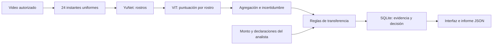

# VeriCall: fuentes, alcance y criterios

## Qué dicen los documentos

Fuentes revisadas en esta carpeta:

1. `GD-Actividades Clave 2026-II.pdf`, pp. 2, 4–11, 15–17 y 34.
2. `1. Entregable sesión 1 - Primer avance del proyecto.docx`.
3. `2. Entregable sesión 2 - Criterios de decisión y condiciones de aceptabilidad VeriCall.docx` (el nombre en disco usa una variante Unicode de «sesión» y «decisión»).

**Objetivo documentado:** diseñar una startup cuyo producto dependa de una decisión crítica sustentada en datos y mecanismos de gobierno. VeriCall plantea decidir, ante una transferencia solicitada por videollamada, entre autorizar o bloquear hasta verificar por un canal alterno. Sirve a tesorería, finanzas y entidades financieras. El daño principal es una transferencia fraudulenta; un falso bloqueo también tiene costo operativo. Fuente: entregable 1, apartados «Startup», «Decisión crítica» y «Criticidad»; PDF pp. 4–7.

**Pregunta del proyecto académico, expresada en el PDF:** «¿Cómo funciona la decisión crítica de nuestra startup y qué mecanismos de Gobierno de Datos permiten confiar en ella?» (p. 9). Los entregables no formulan una pregunta de investigación estadística separada.

**Producto y flujo propuestos por el equipo:** la versión futura se conectaría a la videollamada y al sistema de pagos, analizaría video y audio, contexto de conexión, perfil biométrico e historial de transferencias, y mostraría puntaje, motivos y veredicto a tesorería. El analista confirma en riesgo bajo; en riesgo alto se bloquea y solo se libera tras verificar por otro canal. Esto es una propuesta del entregable 1, no una integración existente.

**Entregable 1 ya establece:** usuarios, problema, decisión crítica, fuentes de datos previstas, costos de errores y riesgos de biometría, sesgo y obsolescencia. **Entregable 2 ya establece:** cinco métricas preliminares, restricciones, puntaje de 0–100 y rangos 0–30 aceptar, 31–70 revisar y 71–100 rechazar. Cuenta nueva o monto superior al límite del cliente exige revisión con cualquier puntaje. Ver la [matriz de trazabilidad](trazabilidad.md).

## Lo que falta en el proyecto académico

| Trabajo | Exigencia del PDF | Estado comprobable aquí |
|---|---|---|
| Avance sesión 3 | Flujo, 3–5 datos críticos, calidad, trazabilidad, vacíos; diagrama y tabla en máximo 2 páginas (p. 16). | No hay entregable de sesión 3 en la carpeta. Este repo aporta una base técnica, pero no sustituye el escrito. |
| Avance sesión 4 | Tres riesgos, matriz riesgo/control, disparadores, autoridad y monitoreo; máximo 2 páginas (p. 17). | No hay entregable de sesión 4 en la carpeta. |
| Escrito final | Ocho partes: startup, decisión, criterios, datos, lógica, riesgos, gobierno y responsabilidades; máximo 10 páginas. El PDF fija 11 de noviembre de 2026 (pp. 2, 9, 13). | No hay escrito final en la carpeta. |
| Sustentación | Defender integralmente esos elementos y condiciones de implementación (p. 11); sesión 5. | No hay presentación en la carpeta. |
| Reality Check, equipo 1 | Comparar cuatro casos del curso y formular tres conclusiones en la sesión 5 (p. 34). | Actividad adicional asignada; no hay material en la carpeta. |

El PDF también asigna al equipo 1 una ponencia en sesión 2 (p. 23) y un examen final individual (p. 2). La ausencia de archivos aquí **no demuestra** que esas actividades estén pendientes.

## Alcance actual: versión 2

La solicitud posterior del usuario amplió el prototipo para incorporar un detector entrenado y ejemplos públicos con personas. La arquitectura y los criterios de esta ampliación se fijaron en [modelo_y_validacion.md](modelo_y_validacion.md).

**Implementado:** aplicación Flask local, reproducción de seis videos de Unidata, carga de archivos propios, inferencia real sobre rostros mediante YuNet y Vision Transformer, muestreo de 24 instantes, clasificación binaria con zona de incertidumbre, reglas de transferencia, cola acotada con progreso, historial SQLite y exportación JSON. Video subido y recortes no se guardan en la bitácora; el archivo temporal se elimina al terminar o fallar el trabajo.

**Datos requeridos:** video autorizado de hasta 100 MB/2 minutos, monto, límite, condición de cuenta nueva y declaración de verificación por otro canal. Las seis muestras tienen etiquetas de referencia proporcionadas por el editor; estas etiquetas no entran al modelo. Los archivos geométricos de la versión 1 permanecen como pruebas negativas de ausencia de rostros.

**Qué usa aprendizaje automático:** YuNet localiza rostros y el Vision Transformer clasifica recortes RGB. **Qué es determinista:** muestreo, agregación, validación, reglas de negocio y registro. **Qué se declara o simula:** la transferencia y la verificación alterna son entradas de demostración; el sistema no llama al directivo ni consulta el ERP ni ejecuta pagos.

**Versión 3, monitoreo en vivo:** cuadros de una llamada simulada, la cámara o la ventana compartida de Zoom/Meet/Teams se analizan durante la llamada. La transferencia se evalúa con la evidencia acumulada y la decisión final la toma una persona con reglas de rol, canal alterno y tiempo objetivo. La bitácora está encadenada por hashes. Ver README.

**Límites de alcance:** no hay audio, análisis temporal aprendido, sincronía labial, reconocimiento de identidad, integración por API de la plataforma de video ni con la banca. Los roles no se autentican. El modelo puede detectar señales visuales de deepfake, pero puede omitir ataques. La prueba de seis clips incluye un falso negativo y se conserva en el informe.

## Criterios de aceptación y evidencia

- Archivos públicos con URLs, revisión y hashes verificados: `config/assets.json`.
- Inferencia real, local, sin utilizar la etiqueta o el nombre del archivo como señal: `vericall/pipeline.py`, `tests/test_prototype.py`.
- Una entrada sin rostro suficiente es inconclusa; un modelo ausente no se reemplaza por una predicción ficticia.
- Consentimiento declarado, valores válidos y archivo decodificable antes de emitir decisión.
- Cuenta nueva o monto alto fuerza revisión; puntaje alto bloquea; evidencia incierta nunca produce recomendación de autorizar.
- Toda decisión aparece únicamente después de persistir su evidencia. Si falla la bitácora, el trabajo falla sin veredicto de pago.
- La evaluación incluye los seis clips elegidos, todos los errores y casos inciertos: `reports/sample_evaluation.json`.

Estos criterios verifican software y una pequeña demostración de detección. No demuestran cumplir las metas del entregable 2: ≥98 % de fraude detenido, ≤2 % de falsos bloqueos, ≤15 minutos, 100 % de trazabilidad operativa o ≤1 punto de brecha entre grupos. Se requiere un estudio representativo e independiente.

## Preguntas pendientes del equipo

Responsabilidad contractual al liberar bloqueos; autenticación del canal alterno y límites; disponibilidad de datos de llamadas y ERP; dataset independiente representativo; política aprobada de acceso y retención; evaluación de sesgos y adaptación a nuevos generadores. Estas cuestiones siguen pendientes antes de un piloto organizacional.
